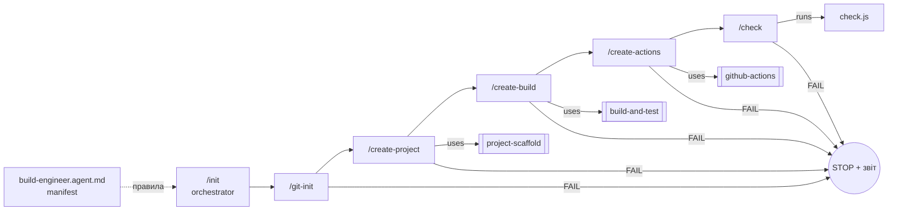

# Архітектура агента build-engineer

## Яку задачу вирішує агент
Перетворює вимоги варіанта 3 (JavaScript + npm scripts + Jest, CI для трьох ОС)
на відтворюваний процес: однаковий запуск `/init` у чистому репозиторії дає
однаковий проєкт, а `/check` об'єктивно підтверджує або спростовує результат.
Агент прибирає ручну рутину (каркас, `package.json`, тести, workflow), але не
приймає рішень, що можуть зашкодити: без дозволу не комітить, не пушить, не
видаляє файли поза `build/`.

## Компоненти

| Рівень | Файл | Роль |
|---|---|---|
| Manifest | `.github/agents/build-engineer.agent.md` | роль, межі, правила, заборони, критерії завершення |
| Skill | `.github/skills/project-scaffold/SKILL.md` | як створити каркас (каталоги, `src/hello.js`, README, `.gitignore`) |
| Skill | `.github/skills/build-and-test/SKILL.md` | як створити складання і тести (`package.json`, `scripts/build.js`, Jest) |
| Skill | `.github/skills/github-actions/SKILL.md` | як створити CI (`ci.sh`, `ci.bat`, `ci.yml`) |
| Command | `.github/prompts/git-init.prompt.md` | стан Git, `.gitignore`, `.gitattributes` |
| Command | `.github/prompts/create-project.prompt.md` | викликає project-scaffold |
| Command | `.github/prompts/create-build.prompt.md` | викликає build-and-test |
| Command | `.github/prompts/create-actions.prompt.md` | викликає github-actions |
| Command | `.github/prompts/check.prompt.md` | лише перевірка (read-only) |
| Orchestrator | `.github/prompts/init.prompt.md` | 1→5, зупинка на першій помилці |
| Tool | `.github/agent-tools/check.js` | детермінована перевірка для `/check` (exit 0/1) |

Skill відповідає на питання **«як»** (знання + шаблони в `templates/`), command —
**«що і коли»** (передумови, дії, очікувані файли, перевірки, повідомлення про
помилку), orchestrator — **«в якому порядку»**.

## Дані між етапами
| Після кроку | Що отримує наступний крок |
|---|---|
| git-init | валідний репозиторій, `.gitignore` з `node_modules/`, `build/` → безпечно встановлювати залежності |
| create-project | `src/hello.js` (функції `greet`, `main`), каталоги `tests/`, `scripts/` |
| create-build | `package.json` зі скриптами `build`/`test`, `node_modules/`, `package-lock.json`, зелені тести |
| create-actions | `ci.sh`/`ci.bat`, що викликають ті самі npm scripts; `ci.yml` |
| check | таблиця PASS/FAIL і код виходу → підсумок `/init` |

Параметри (`projectName`, `testName`, `branches`, `nodeVersion`) задаються в
таблиці `/init` і передаються командам як `key=value`.

## Обробка помилок оркестратором
1. Кожна command має розділ «Перевірки»; оркестратор виконує їх після кроку.
2. Перший `FAIL` → зупинка: `init: STOPPED at step n/5 (<command>) — <причина>`.
   Наступні кроки не виконуються, бо залежать від попередніх (наприклад,
   `create-actions` без робочого `npm test` створив би «зелений» лише на папері CI).
3. Заборонено маскувати помилки (`|| true`, `test.skip`, видалення перевірок).
4. `/check` повертає `FAIL`, якщо не пройшла хоча б одна перевірка; `check.js`
   повертає exit code 1 — це не залежить від «думки» LLM.
5. Ідемпотентність: повторний запуск дає `SKIP`, файли не дублюються, блоки в
   README/usage замінюються між маркерами.

## Відповідність формату середовища
Використано формат **GitHub Copilot у VS Code** (рекомендований методичкою):

| Методичка | У репозиторії | Примітка |
|---|---|---|
| `.github/agents/build-engineer.agent.md` | так само | custom agent Copilot (frontmatter `name`, `description`, `tools`) |
| `.github/prompts/*.prompt.md` | так само | prompt files, запуск `/<назва>` у Copilot Chat; `agent: build-engineer` |
| `.github/skills/*/SKILL.md` | так само + `templates/` | Agent Skills; шаблони — еталонні файли для відтворюваності |
| `CMakeLists.txt` | `package.json` + `scripts/build.js` | варіант 3: npm scripts замість CMake |
| — | `.github/agent-tools/check.js` | додано: детермінована частина `/check` |
| — | `CLAUDE.md`, `.claude/commands/*.md` | додано: ті самі команди для Claude Code, тонкі обгортки над `.github/prompts/` |

Агентські файли згенеровано за допомогою Claude Code (модель Claude Opus 5.5),
формат сумісний з GitHub Copilot.
